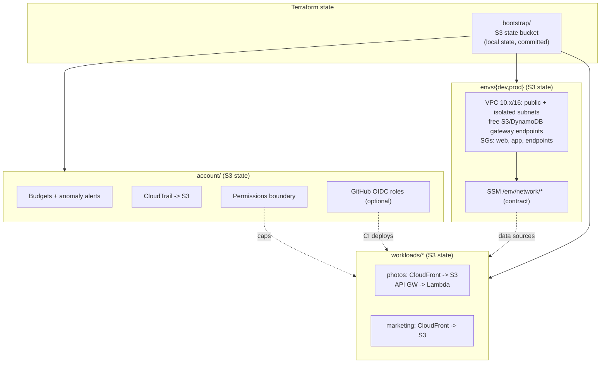

# Architecture

## Principles
1. **Serverless first.** Lambda, S3, CloudFront, DynamoDB, API Gateway. No servers to patch, nothing billed while idle.
2. **No fixed monthly cost** beyond the Route 53 zone (~$0.50). See [cost.md](cost.md).
3. **Isolation without multiple accounts.** One account, isolated by separate state, IAM boundaries, per-env VPCs and tags. A move to AWS Organizations member accounts is the documented next step ([ADR 0003](adr/0003-single-account.md)).
4. **No static credentials.** SSO for humans, GitHub OIDC for CI.

## Layers

## Network model (per env)
- **Public subnets** (IGW route) for the rare internet-facing resource. `map_public_ip_on_launch = false`.
- **Isolated subnets**: no internet route. Reach S3/DynamoDB over free gateway endpoints. AWS APIs beyond those need an interface endpoint (paid, off by default) or the optional NAT instance.
- **Security groups**: `web` (443 in) -> `app` (no ingress except from web) -> `endpoints`. Default SG has no rules. No SSH anywhere: SSM Session Manager.
- **Most workloads don't use the VPC at all.** Lambda outside a VPC has internet access and costs nothing extra. Use the VPC only for things that genuinely need it (private data stores, the homelab link).

## Workload contract
A workload is its own Terraform root and state (`workloads/<name>/<env>`). It consumes the shared baseline only through SSM parameters under `/<env>/network/` and the IAM boundary named `workload-permissions-boundary`. That keeps blast radius per workload and avoids cross-state coupling.

## Isolation model
| Boundary | Mechanism |
|---|---|
| env vs env | Separate VPCs and CIDRs, separate state keys, separate SSM paths |
| workload vs workload | Separate state, own IAM roles with permissions boundary, own buckets/distributions |
| CI vs humans | OIDC roles scoped to repo/branch; SSO permission sets for humans |
| Cost control | Boundary denies fixed-price services; budget + anomaly alerts |

## Homelab / WireGuard (later)
AWS Site-to-Site VPN does **not** speak WireGuard and costs about $36/month per connection, so it is excluded. When needed: a `t4g.nano` WireGuard instance in a public subnet of the baseline (~$3-4/month), SSM-only admin, WireGuard UDP port restricted to the homelab's address, and routes for the homelab CIDR added to the isolated route table. Pick non-overlapping CIDRs first (check the homelab ranges before choosing). Not built yet.

## Regions
`us-east-1` primary (CloudFront certificates must be there), `us-east-2` allowed. The permissions boundary denies other regions for non-global services.
